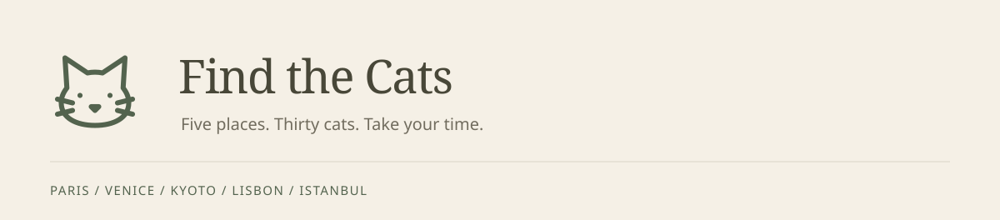

# Find the Cats

A quiet hidden-cat game in a travel sketchbook, drawn in graphite on warm ivory paper.




## Features

- Five places to explore: Paris, Venice, Kyoto, Lisbon, and Istanbul.
- Six cats in every drawing, with a gentle pencil-lightening reveal.
- Just the illustration and a small cat counter, with the whole picture kept in view.
- Pinch and drag to look closer, or use the keyboard.
- Find all six to travel onward; pictures shuffle without repeating, including on refresh.
- A development-only editor for tracing cat outlines and forgiving tap regions.

## Quick start

Requires Node.js 24 or later.

```bash
npm ci
npm run dev
```

Open the local URL printed by Vite.
The polygon editor lives at `/editor` during development.
Build with `npm run build`, then serve `dist/` as a static site.
Fonts and artwork are bundled locally; playing needs no account, API key, or backend.

## A closer look

Tap or click a cat to find it.
On a touch screen, pinch to zoom and drag to explore.
With the picture focused, use `+` / `-` to zoom, arrow keys to pan, and `0` to reset.

Run `npm run lint` and `npm test` for code and geometry checks.
Install Chromium with `npx playwright install chromium`, then run `npm run test:e2e` for desktop and phone gameplay checks.

## Docs

- [Gameplay and artwork](docs/gameplay.md) - scene data, interaction, storage, and adding illustrations.
- [Design system](DESIGN.md) - ivory paper, graphite, botanical green, and an interface that stays out of the picture.
